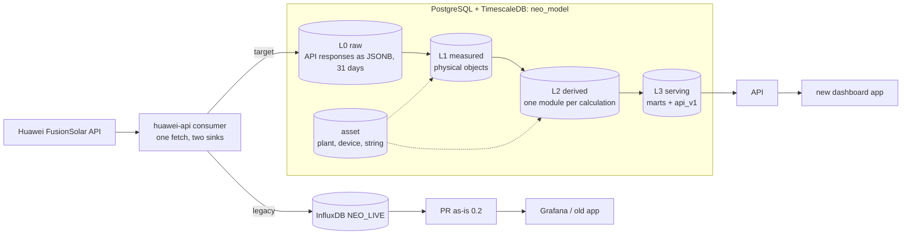

# neo-pr-next

**The NEO data platform for solar PV monitoring and performance analysis.** This repository holds the data model and the processing that
take NEOVision's plants from the raw Huawei FusionSolar API to the dashboard: a physical asset model down to the PV string, measured time
series, performance ratio (PR) by **IEC 61724-1** and by **the customer's contractual method**, and the serving layer for the new app.
It runs on PostgreSQL 18 + TimescaleDB 2.31.

| | |
|---|---|
| **Status** | **Pipeline B runs end to end** (2026-11-22): the consumer writes L0 to Postgres (no Mongo), `neo-model` 0.3 builds L1 and runs the PR modules, `neo-api` serves `api_v1` at `http://10.0.0.180:20021`. The customer method is validated against the old system: 100 % of the 5-minute values match |
| **Scope** | 49 plants, 1,066 devices, 2,881 strings; PR for the 13 plants with a PR configuration |
| **Next** | the new dashboard app on `api_v1`, then the cut-over (Influx, PR as-is and Grafana retired); see [ROADMAP](docs/ROADMAP.md) |

---

## Architecture



There are **two pipelines** while we transition. Both are fed by the same API calls:

- **Pipeline A, legacy (frozen):** Influx + PR as-is 0.2 + Grafana. It keeps today's numbers alive and is the reference. It gets no new
  development and is retired at the cut-over.
- **Pipeline B, target:** the consumer lands every API response unchanged in **L0** (Postgres JSONB, kept 31 days). This replaces the Mongo
  cache. From there, **modules** derive everything else. A module is small, versioned and idempotent, and writes only its own outputs.
  Changing a PR method, adding a KPI, running a **simulation** or an **extrapolation** means adding or versioning one module. The other
  modules, the stored measurements and the app do not change.

Full description, module contract and migration plan: **[docs/PIPELINE.md](docs/PIPELINE.md)**.

## Layers

| Layer | Schema | Holds | Rule |
|---|---|---|---|
| L0 raw | `raw`, `src` | API responses as received; master data and sync state as delivered | unchanged, 31 days |
| assets | `asset` | plant → device → PV string, module types, contract factors, with validity periods | history kept, never overwritten |
| L1 measured | `ts` | typed measurements in SI-style units per physical object | measured only, never corrected in place |
| L2 derived | `calc` | PR (IEC, customer), string PR, and later availability, losses, simulations, estimates | every row has `method`/`version`/`run_id` |
| L3 serving | `rpt`, `api_v1` | aggregates and marts for the app; `api_v1` is the contract | rebuildable |
| quality | `dq` | master-data and data findings | for people to act on |

## Repository layout

```
sql/migrations/    numbered DDL 001…017 (base, asset, L1, calc, rpt, dq, compat, L0/src, l1 loader, modules, api_v1 …); sql/migrate.sh
service/           neo-model service: asset sync, L1 load, module orchestrator (Python 3.11, Dockerfile)
tests/             validate.sql (customer method vs. the old system), compare_l1_sources.sql (L1 from L0 vs. from Influx)
tools/             load_reference.py: loads the old system's results as the reference
deploy/            copies of the Kubernetes manifests neo-model.yaml, api.yaml (source of truth: rad_argocd tenants/neo/)
docs/              the documentation (below)
```

## Documentation

| Document | Read it for |
|---|---|
| [PIPELINE.md](docs/PIPELINE.md) | the two pipelines, stages, module contract, Mongo replacement, migration plan |
| [MODEL.md](docs/MODEL.md) | every table and column, units, ERD, mapping from the Huawei API |
| [METHODS.md](docs/METHODS.md) | the PR formulas: IEC 61724-1 and the customer method, the customer day, the old system's faults |
| [OPERATIONS.md](docs/OPERATIONS.md) | configuration, deployment, migrations, recalculation, monitoring |
| [VALIDATION.md](docs/VALIDATION.md) | the comparison with the old system, and how to rerun it |
| [DATA_QUALITY.md](docs/DATA_QUALITY.md) | the `dq` views and the master-data findings for the customer |
| [DECISIONS.md](docs/DECISIONS.md) | design decisions and their reasons |
| [ROADMAP.md](docs/ROADMAP.md) | what comes next |

## Quick start

Requirements: PostgreSQL 18 with TimescaleDB 2.31 and `btree_gist`; Python 3.11 for the service.

```bash
# schema (an empty database created from template0, see docs/OPERATIONS.md §4)
PGHOST=… PGPORT=… PGUSER=neo_owner PGPASSWORD=… PGDATABASE=neo_model sql/migrate.sh

# one service cycle by hand (configuration by environment, see docs/OPERATIONS.md §2)
pip install -r service/requirements.txt
ONCE=1 PG_HOST=… PG_USER=… PG_PASSWORD=… INFLUX_HOST=… INFLUX_USER=… INFLUX_PASSWORD=… python service/neo_model.py
```

```bash
# the read API (PostgREST; filters: column=eq.value, gte., lt., in.(…); select=…; order=…)
curl 'http://10.0.0.180:20021/pr_daily?level=eq.plant&day=eq.2026-11-21&select=plant_code,method,version,pr,pr_xze'
curl 'http://10.0.0.180:20021/plant_power_5min?plant_code=eq.NE=51345970&slot=gte.2026-11-22T00:00:00Z'
curl 'http://10.0.0.180:20021/'                      # OpenAPI description of every endpoint
```

```sql
-- yesterday's PR per plant, both methods
SELECT plant_code, method, round(pr::numeric, 3) AS pr, round(pr_xze::numeric, 3) AS pr_xze
FROM rpt.pr_daily WHERE level = 'plant' AND day = current_date - 1 ORDER BY plant_code, method;

-- strings more than 10 % below their plant's median yesterday
SELECT plant_code, inverter, string_no, round(ratio_to_median::numeric, 2)
FROM rpt.string_health_daily WHERE day = current_date - 1 AND ratio_to_median < 0.9 ORDER BY ratio_to_median;
```

## Conventions

- **Units are part of the column name:** `_kw`, `_kwh`, `_w_m2`, `_kwh_m2`, `_c`, `_pct`. Conversions happen once, in L1.
- **Time:** `timestamptz`, stored in UTC; local days in `Asia/Bangkok`.
- **Schema changes only through a new migration.** An applied migration is never edited.
- **A changed calculation is a new version**, computed next to the old one. Numbers already reported never change silently.
- **No secrets in the repository.** Configuration comes from the environment (a SealedSecret in Kubernetes).

## Related

| | |
|---|---|
| Huawei consumer | repo `ait-iot-dev/hauwei-api-v2` (writes the sinks) |
| Old PR system | `iox.neoclean.performance_ratio.management`, image 0.2 (frozen, runs as pod `pr`) |
| Deployment | repo `AIT-AI/rad_argocd`, `tenants/neo/` (Argo CD app `iotonix-neo`) |

Proprietary. © AIT / IOTONIX for NEOVision.
