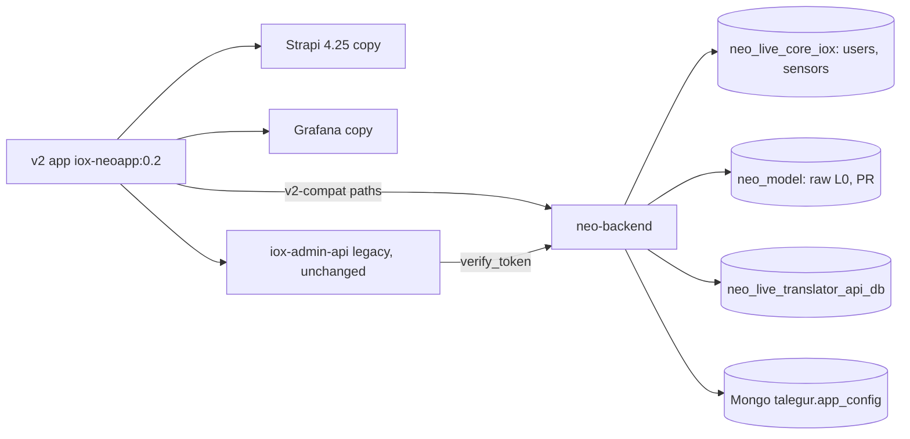

# NEO backend (consolidated API)

One API for the NEO apps. **Phase 1 (2026-11-24): v2-compat layer.** It serves the legacy paths and response shapes that the existing
Angular app `iox.neo.app.v2` calls, so v2 runs unchanged on our local data as the **benchmark and test environment** for the v3 rewrite.
Clean v3 endpoints follow under `/v1`.

| Route (v2-compat) | Source |
|---|---|
| `POST /api/User/Login` | `neo_live_core_iox.accounts` (bcrypt); JWT HS256, aud `IOX4`, claim `authorities` (`R_ADMIN`/`R_USER`/`R_CUSTOMER`) like IOX4 auth |
| `POST /auth/auth/verify_token` | token check for the legacy `iox-admin-api` |
| `GET /api/Sensor` | `sensors` + `sensor_categories` + `sensor_state` (customers: only their gateways) |
| `GET /express/js/sensorValues/lastUpdate` | newest round of raw `getDevRealKpi` / `getStationRealKpi` in `neo_model.raw.api_response` (replaces Mongo `lastSensorValueUpdate`) |
| `GET /app-config/by_name/{app}` | `talegur.app_config`, with `server_ip` and `gf_api_key` rewritten for this host |
| `GET /translator-api/app-translations/by_name/{app}/{locale}` | `neo_live_translator_api_db` |
| `/auth/api/v1/accounts…`, `/core/api/v1/gateways` | user admin on `neo_live_core_iox` |
| `POST /iox-compute-service/api/v1/performance_ratio/calculation/actual/daterange` | `calc.pr_interval` (`neo_customer`), energy-weighted per inverter |

Not served (left out on purpose): LINE, e-mail, SMS, partner API. OpenAPI: `https://aiiot.ait.co.th/neo-backend/docs`.

Build: `docker build -t registry.ait.co.th/iotonix/neo-backend:<v> backend/`. Deploy: rad_argocd `tenants/neo/neo-app.yaml`
(SealedSecret `neo-backend-env`). Test: the browser test in the commit message of the deploy.
