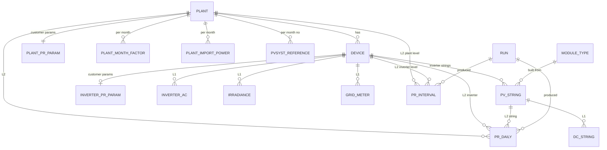

# NEO data model

PostgreSQL 18 + TimescaleDB 2.31. Database `neo_model` on the NEO tenant Postgres (`iotonix-neo/postgres-0`, `10.0.0.180:20019`).
The DDL is in `sql/migrations/` (numbered, applied once each by `sql/migrate.sh`). This document describes what the migrations create.

## 1. Principles

| Principle | How |
|---|---|
| **A physical model, not an API mirror** | Tables are named after physical things (plant, inverter, string, irradiance sensor, grid meter), not after Huawei endpoints. The vendor mapping lives in one place (§4). |
| **Clear layers** | `asset` (the plant) · `raw` (L0, as received) · `ts` (L1, measured) · `calc` (L2, derived) · `rpt` (L3, reporting) · `dq` (data quality) · `compat` (old names). Data flows one way: L0 → L1 → L2 → L3. |
| **Units in every name** | `_kw`, `_kwh`, `_w`, `_kvar`, `_v`, `_a`, `_w_m2`, `_kwh_m2`, `_c`, `_pct`, `_pct_per_c`, `_hz`, `_h`. Conversions happen once, at ingest (§4). |
| **Time** | `timestamptz` everywhere (stored in UTC). Local days are `Asia/Bangkok` (`asset.plant.timezone`). |
| **History of configuration** | Configuration rows carry `valid tstzrange`. A change closes the current row and opens a new one; exclusion constraints forbid overlaps. Current rows: `upper(valid) = 'infinity'`. |
| **Reproducible results** | Every L2 row names its `method`, `version` and `run_id` (`calc.run`). Methods live side by side; a new version is computed next to the old one. |
| **Idempotent** | L1 inserts are `ON CONFLICT DO NOTHING`; L2 is upserted. Any period can be re-run. |
| **Lineage** | `source` on asset rows, `run_id` on L1/L2 rows, `calc.run` with parameters and row counts. |

## 2. Overview



```
Huawei API ──► (consumer v2) ──► Influx NEO_LIVE ──► neo-model ingest ──► ts.*  (L1)
                                                                      │
pr_live_neodb (PR config) ──► neo-model asset sync ──► asset.*        ├──► calc.compute_intervals() ──► calc.pr_interval (L2)
                                                                      └──► calc.compute_daily()     ──► calc.pr_daily    (L2)
                                                     Timescale jobs ──► rpt.* continuous aggregates (L3); compression
```

## 3. Tables and views

### asset: the physical plant (`002_asset.sql`)

| Table | Key | Content |
|---|---|---|
| `asset.plant` | `plant_id`, unique `code` (Huawei stationCode `NE=…`) | name, account, coordinates, timezone, `capacity_dc_kwp` (recorded), `cod_date`, `guarantee_years`, `g_ref_w_m2` (1000), `pr_active` |
| `asset.plant_pr_param` | `plant_id` | customer plant PR parameters: `string_cap_w` (P0 of the plant PR), `panels`, `globinc_pct`, `temp_coeff_pct_per_c` |
| `asset.device` | `device_id`; unique (`vendor`, `vendor_device_id`, `valid`) | `kind` (`inverter`, `irradiance_sensor`, `grid_meter`, `logger`), Huawei devId, ESN, name, model, `is_primary` (the EMI and grid meter PR uses), `valid` |
| `asset.inverter_pr_param` | `device_id` | customer inverter parameters (daily PR, CK/TCF): `string_cap_w`, `panels`, `module_wp`, `globinc_pct`, `temp_coeff_pct_per_c`, `g_ref_w_m2` |
| `asset.module_type` | `module_type_id` | `pmax_stc_w`, `gamma_pct_per_c`; `noct_c`, `area_m2`, manufacturer, model (not known today) |
| `asset.pv_string` | `string_id`; no overlap per (`inverter_id`, `string_no`, `valid`) | `string_no` (Huawei pv<N>), `mppt_no`, `module_type_id`, `modules_count`, `stc_capacity_w` (P0), `poa_factor` (GlobInc % / 100), `tilt_deg`, `azimuth_deg`, `enabled`, `configured` (false = observed in data only), `valid` |
| `asset.plant_month_factor` | (`plant_id`, `month`) | PVsyst / contract values: `temp_ref_c`, `degradation_pct`, `degrade_cap_pct`, `warranty_pct`, `availability_pct` |
| `asset.plant_import_power` | (`plant_id`, `month`) | monthly "import power zero" threshold `value_kw` (the xze filter of month M uses M−1), `method`, `static` (set by hand) |
| `asset.pvsyst_reference` | (`plant_id`, `month_no`) | PVsyst reference temperature per calendar month |
| view `asset.pv_string_current` | | current string rows |
| view `asset.inverter_capacity` | `inverter_id` | P0 (kW), panel-weighted `poa_factor`, capacity-weighted `gamma_pct_per_c`, string count, from the current configured and enabled strings |

### raw: L0 (`003_raw_ts.sql`)

`raw.api_response` (hypertable on `fetched_at`, 1-day chunks): `source`, `account`, `endpoint`, `request` jsonb, `response` jsonb, `fail_code`,
`run_id`. Planned writer: the Huawei consumer (replacing the Mongo cache). Not yet written.

### ts: L1 measured values (`003_raw_ts.sql`), hypertables with 7-day chunks

| Table | Key | Columns |
|---|---|---|
| `ts.inverter_ac` | (`device_id`, `time`) | `active_power_kw`, `reactive_power_kvar`, `power_factor`, `frequency_hz`, `u_ab_v`, `u_bc_v`, `u_ca_v`, `i_a_a`, `i_b_a`, `i_c_a`, `energy_day_kwh` (cumulative per local day), `energy_total_kwh`, `dc_power_kw`, `temperature_c`, `efficiency_pct`, `state`, `quality`, `run_id` |
| `ts.dc_string` | (`string_id`, `time`) | `voltage_v`, `current_a`, `power_w` (generated = V × I), `quality`, `run_id` |
| `ts.irradiance` | (`device_id`, `time`) | `poa_w_m2`, `poa_total_kwh_m2` (cumulative per local day), `ghi_w_m2`, `ghi_total_kwh_m2`, `module_temp_c`, `ambient_temp_c`, `wind_speed_m_s`, `wind_direction_deg`, `quality`, `run_id` |
| `ts.grid_meter` | (`device_id`, `time`) | `active_power_kw` (negative = export), `reactive_power_kvar`, `power_factor`, `frequency_hz`, `energy_forward_kwh` (cumulative, from the grid), `energy_reverse_kwh` (cumulative, to the grid), `quality`, `run_id` |

### calc: L2 derived values (`004_calc.sql`, `005_calc_functions.sql`)

| Object | Content |
|---|---|
| `calc.run` | one row per service step (`assets`, `ingest`, `intervals`, `daily`): method, version, params, start/end, status, rows |
| `calc.watermark` | service state (`ingest` = data loaded until) |
| `calc.pr_interval` | hypertable; PR per 5-minute interval at **inverter** level (`inverter_id` set) and **plant** level (`inverter_id` NULL), unique (`method`, `version`, `plant_id`, `inverter_id`, `time`). Common: `slot`, `interval_s`, `energy_kwh`, `p0_kw`, `h_meas_kwh_m2`, `h_poa_kwh_m2`, `yf_h`, `yr_h`, `pr`, `module_temp_c`. IEC: `c_k`, `pr_temp_corrected`. Customer: `grid_connected`, `power_limited`, `grid_import`, `meter_power_kw`, `ipz_threshold_kw`, `included`, `exclusion_reason`, `energy_xze_kwh`, `h_xze_kwh_m2`, `pr_xze`, `tmod_c`, `ck`, `tcf`, `pr_ck`, `pr_tcf` |
| `calc.pr_daily` | PR per day at **plant**, **inverter** and **string** level, unique (`method`, `version`, `level`, `plant_id`, `inverter_id`, `string_id`, `day`): `energy_kwh`, `p0_kw`, `h_poa_kwh_m2`, `pr`, `pr_temp_corrected`, `tmod_c`, `energy_xze_kwh`, `h_xze_kwh_m2`, `pr_xze`, `ck`, `tcf`, `pr_ck`, `pr_tcf`, `pr_epc_ck`, `pr_epc_tcf`, `daylight_h`, `ze_h`, `intervals` |
| function `calc.compute_intervals(from, to, version, run_id)` | fills `calc.pr_interval` (both methods, both levels) |
| function `calc.compute_daily(day_from, day_to, version, run_id)` | fills `calc.pr_daily` from `calc.pr_interval` (and `ts.dc_string` for the string level) |
| view `calc.string_pr_instant` | instantaneous DC PR per string sample, IEC and customer (`pr_asis_pv<N>`), computed on demand (not stored) |

Formulas and rules: [METHODS.md](METHODS.md).

### rpt: L3 reporting (`006_rpt.sql`)

| Object | Kind | Content |
|---|---|---|
| `rpt.inverter_energy_daily` | continuous aggregate | per local day and inverter: energy, peak power, samples |
| `rpt.string_daily` | continuous aggregate | per local day and string: approximate energy (5-min samples), max current, mean voltage |
| `rpt.irradiation_daily` | continuous aggregate | per local day and sensor: POA irradiation, peak irradiance, mean module temperature in daylight |
| `rpt.plant_power_5min` | continuous aggregate | per 5-minute slot and inverter: mean power, energy counter |
| `rpt.pr_daily` | view | `calc.pr_daily` with plant code/name, inverter name and string number |
| `rpt.string_health_daily` | view | daily DC string PR against the plant median (`ratio_to_median`) |

### dq: data quality (`008_dq.sql`)

`dq.unknown_sensor` (table, written by the service), views `dq.plant_capacity`, `dq.string_config`, `dq.silent_device`,
`dq.pr_prerequisites`. See [DATA_QUALITY.md](DATA_QUALITY.md).

### compat: the old field names (`009_compat.sql`)

`compat.getdevrealkpi_1_pr`, `compat.getstationrealkpi_pr`, `compat.getioxdailykpi_plant`, `compat.getioxdailykpi_1` reproduce the Influx PR
fields of PR as-is 0.2 (incl. its daily-inverter scale, `*_asis_scale`) from the new model, for dashboard transition and comparisons.

## 4. Source mapping (Huawei northbound API via Influx `NEO_LIVE`)

| Target | Source measurement / field | Conversion |
|---|---|---|
| `asset.device.vendor_device_id` | tag `sensorId` (= Huawei devId) | |
| `ts.inverter_ac` | `GetDevRealKpi_1`: `active_power`, `reactive_power`, `power_factor`, `elec_freq`, `ab_u`, `bc_u`, `ca_u`, `a_i`, `b_i`, `c_i`, `day_cap`, `total_cap`, `mppt_power`, `temperature`, `efficiency`, `inverter_state` | none (kW, kvar, kWh) |
| `ts.dc_string` | `GetDevRealKpi_1`: `pv<N>_u`, `pv<N>_i` → string `string_no = N` | none; an input without configuration becomes an observed string at ≥ 1 A |
| `ts.irradiance` | `GetDevRealKpi_10`: `radiant_line`, `radiant_total`, `horiz_radiant_line`, `horiz_radiant_total`, `pv_temperature`, `temperature`, `wind_speed`, `wind_direction` | `radiant_total` and `horiz_radiant_total` are MJ/m²: **/ 3.6** → kWh/m² |
| `ts.grid_meter` | `GetDevRealKpi_17`: `active_power`, `reactive_power`, `power_factor`, `grid_frequency`, `active_cap`, `reverse_active_cap` | `active_power` (W) and `reactive_power` (var): **/ 1000** |
| `asset.*` | PR configuration database (`pr_live_neodb`): `plant_information`, `plant_devices`, `inverter_information`, `inverter_configurations`, `plant_monthly_factor_configurations`, `plant_import_power_history`, `plant_pvsyst_reference` | `ic_glob_inc_pcnt` / 100 → `poa_factor`; `piph_value` (W) / 1000 → `value_kw` |

Not ingested (yet): the station measurements (`GetStationRealKpi`, `GetStationHourKpi`, `GetKpiStationDay`), the device daily KPIs
(`GetDevKpiDay_1`), alarms (`GetAlarmListFlattened`); and the PR fields PR as-is writes back into the measurements (they are recomputed in L2).

## 5. Sizes (13 PR plants; all 49 plants are ingested)

One week of L1 for the 13 PR plants is ~350 MB uncompressed, ~66 MB compressed (DC strings 286 → 44 MB). L2 for 30 days: ~2 M
interval rows. Compression: L1 after 7 days, L2 after 14 days, L0 after 3 days.
