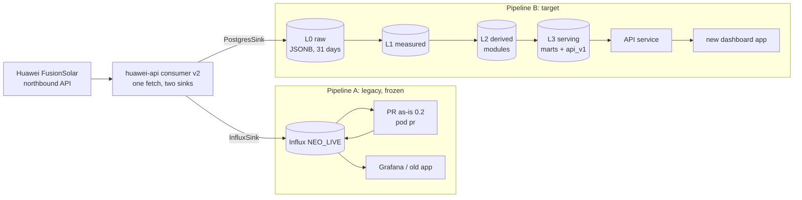
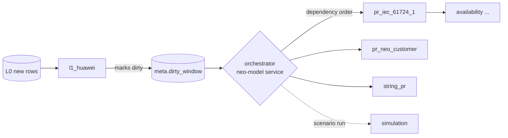

# Data pipeline

How data moves from the Huawei FusionSolar API to the dashboard app. The document has three parts: the two pipelines (the legacy one and the
target), the stages of the target pipeline, and the **module contract**. Under that contract, a new calculation, a changed PR method, a
simulation or an extrapolation is a small module of its own, not a change to the pipeline.

> Status legend: ✅ running · 🟡 running as an interim solution · ⬜ designed, not built.

## 1. Two pipelines

| | Pipeline A (legacy) | Pipeline B (target) |
|---|---|---|
| Purpose | keeps today's numbers and dashboards alive; reference for validation | the product: physical model, both PR methods, string level, simulations |
| Store | InfluxDB 1.8 `NEO_LIVE` (+ Mongo `NeoLive` as API cache) | PostgreSQL 18 + TimescaleDB 2.31, database `neo_model`; **no Mongo** |
| Calculation | PR as-is 0.2 (Django, row by row, writes back into the same measurements) | modules (§3), set-based SQL or Python, each writes only its own outputs |
| Consumers | Grafana, `iox.neo.app.v2` | API `api_v1` → the new dashboard app |
| Changes | **none** (frozen: fixes only if production breaks) | all new development |
| End | retired at the cut-over (§5, phase P6) | – |

Both pipelines are fed by **the same fetch**. The consumer calls each Huawei endpoint once and hands the response to every sink. There
are never two consumers on the same accounts (the API quota), and the two pipelines can be compared one to one.

## 2. Stages of pipeline B

| Stage | Layer / schema | Content | Written by | Kept |
|---|---|---|---|---|
| **S0 acquire** | – | calls the API on a schedule, handles login, quota and retries | `huawei-api` (consumer) | – |
| **S1 land** | **L0** `raw.api_response`; `src.*` | every API response **unchanged** as JSONB, with request, account, endpoint, fetch time and fail code; the master data as delivered (`src.station`, `src.device`), alarms (`src.alarm`), sync state (`src.sync_state`) | consumer, `PostgresSink` | **31 days** (retention policy), the cache that replaces Mongo; `src.*` current state + first/last seen |
| **S2 normalise** | **L1** `ts.*`, `asset.*` | typed, unit-converted measurements per physical object (inverter AC, DC string, irradiance, grid meter, station/day KPIs); the asset model with validity periods | module `l1_huawei`, module `asset_sync` | forever (compressed after 7 days) |
| **S3 derive** | **L2** `calc.*` | everything computed: PR (IEC, customer), string PR, availability, losses, expected power, simulations, gap estimates; every row has `module`, `version`, `run_id` (and `scenario_id` where relevant) | one **module** per calculation (§3) | forever; old versions until deleted on purpose |
| **S4 serve** | **L3** `rpt.*`, `api_v1.*` | continuous aggregates and marts per use case; `api_v1` views are the **contract** with the app (stable names, versioned schema) | Timescale jobs, migrations | derived, rebuildable |
| **S5 present** | – | API service (read-only role) → dashboard app | API, app | – |

Rules that hold for every stage:

1. **Data only flows downward.** A stage reads only the layer below it (and `asset`). Nothing writes back into a lower layer.
2. **Measured is never overwritten by derived.** L1 holds what was measured. Corrections, gap fills and extrapolations are L2 outputs,
   flagged as `estimated`, and never mixed into L1.
3. **Every layer can be rebuilt from the one below.** L1 can be rebuilt from L0 within its 31 days; L2 and L3 can be rebuilt from L1 at
   any time.
4. **Idempotent.** Re-running any module for any window gives the same rows (upsert on the natural key).
5. **Lineage.** Every row can be traced back: L1 → `run_id` → the L0 rows (`raw_id`); L2 → module, version, run, parameters.

### 2.1 Mongo replaced

| Mongo today (consumer v2) | Role | Pipeline B |
|---|---|---|
| `GetDevRealKpi_1/_10/_17`, `GetStationRealKpi`, `GetStationHourKpi(RAW)` | API response cache (~136 k docs/day, pruned to 30 days by hand) | `raw.api_response` (JSONB, retention 31 days, automatic) |
| `GetKpiStationDay`, `GetDevKpiDay_1` (kept forever on prod) | daily KPIs | L1 `ts.station_period` (period `day`), `ts.device_day` (forever); raw 31 days |
| `Stations`, `GetDevList` | master data that the consumer **reads back** to know what to fetch | `src.station`, `src.device`; the consumer's getters read from Postgres |
| `talegur.lastSensorValueUpdate` | last update per sensor | `src.sync_state` |
| `GetAlarmList` (raw), `NotificationHistory`, consolidated alarm list | alarm intake and notification state | raw → L0; notification state → `src.alarm_notification`. **The alarms themselves are already in Postgres:** the consumer keeps `"GetAlarmListFlattened"` in `neo_live_iox` (insert new, set `clearedTime`), and the app reads it (`alarms-pg`); this stays as it is until the app redesign moves it into `src.alarm` |
| `Escalations`, `user_groups`, `email_log` (app data, not written by v2) | app features | move with the app redesign (owner: the new app), not part of the consumer change |

The consumer's Mongo access sits in a few places: `database/mongo/getters.py`, one block per fetcher in `controller/data_fetchers/*`, and
`helpers/mongodb_client.py`. These are replaced by a repository interface with a Postgres implementation.

### 2.2 Schedule (consumer, Asia/Bangkok)

| Job | When | Endpoint(s) | L1 target |
|---|---|---|---|
| `realtime` | every 5 min, 05:00–18:55, plus 19:00 | `getDevRealKpi` (inverter 1, EMI 10, meter 17), `getStationRealKpi` | `ts.inverter_ac`, `ts.dc_string`, `ts.irradiance`, `ts.grid_meter`, `ts.station_real` |
| `hour` | :37, 07–21 h | `getKpiStationHour` | `ts.station_period` (period `hour`) |
| `daily` | 19:30 | `getDevKpiDay`, `getKpiStationDay` | `ts.device_day`, `ts.station_period` (period `day`) |
| `alarm` | every 30 min | `getAlarmList` | `neo_live_iox."GetAlarmListFlattened"` (today) → `src.alarm` (with the app redesign) |
| `sync_stations` / `sync_devices` | 19:45 / 19:47 | `stations`, `getDevList` | `src.station`, `src.device` → `asset_sync` |
| `auth` | 3×/h | `login` | – |
| `history` | **disabled** (it deletes real-time Influx data) | `getDevHistoryKpi` | – |

## 3. Modules: the unit of change

A **module** is the smallest unit of processing. Everything from L1 onwards is a module: normalising, asset sync, every PR method,
availability, loss analysis, the physical expected-power model, simulations and extrapolations.

### 3.1 Contract

Every module declares the following and must keep to it:

| Item | Meaning |
|---|---|
| `name`, `version` | e.g. `pr_neo_customer` `v2`. A new version is computed **next to** the old one, never over it |
| `layer` | L1, L2 or L3 |
| `inputs` | the relations it reads (L1 tables, `asset.*`, outputs of other modules) |
| `outputs` | the relations it writes; **only this module writes them** |
| `grain` | the time unit it works in (sample, 5 min, day, month) |
| `params` | parameters as JSON (stored per run) |
| `lookback` | how far back new or late input can change its output |
| `compute(window, params, run_id)` | computes the window `[t0, t1)` and upserts; a SQL function or a Python class, same contract |

Registered in `meta.module` (name, version, layer, inputs, outputs, enabled), run history in `calc.run`.

### 3.2 Orchestration: dirty windows

1. A module that writes rows for `[t0, t1)` marks that window **dirty** for every module that reads its output (`meta.dirty_window`).
2. Each cycle (every 5 min), the orchestrator runs the enabled modules in dependency order on their dirty windows. It extends each window
   by the module's `lookback`, rounds it to the module's grain, and clears the window after a successful run.
3. **A new module or a new version** gets its whole history marked dirty once. It backfills in the background and does not touch the
   other modules.
4. A failed module stops only its own downstream modules. The rest of the pipeline continues; the window stays dirty and is retried.

### 3.3 What a change costs

| Change | What you do | What does not change |
|---|---|---|
| Fix or change a PR method | new version of that one module (`pr_neo_customer` v3); it backfills next to v2; compare; switch the `api_v1` view to v3 | L0, L1, every other module, the app |
| New KPI (availability, losses, soiling) | new module, own output table, register it | everything else |
| **Simulation** (what-if: other modules, tilt, cleaning interval) | module `simulation` with `calc.scenario` (id, params); outputs keyed by `scenario_id`; baseline = measured | measured data and the official PR (scenario 0) |
| **Extrapolation / gap fill / forecast** | module writes `calc.estimate_*` with `quality = 'estimated'` and the method; reporting chooses measured, or measured + estimated | L1 stays measured only |
| A second vendor | new L1 normaliser `l1_<vendor>` from its own L0 endpoint rows | L2 modules (they read physical L1 tables, not vendor data) |
| New app page | new `rpt` mart or `api_v1` view | calculations |

### 3.4 Modules (status 2026-11-22)

The registry is `meta.module`; this table mirrors it.

| Module | Version | Layer | Entry point | Status |
|---|---|---|---|---|
| `asset_sync` (PR configuration → `asset.*`, validity history) | v2 | L1 | Python (`sync_assets`) | ✅ every 6 h |
| `l1_huawei` (L0 → `ts.*`: devices, stations, daily KPIs) | v2 | L1 | `l1.load_huawei` | ✅ **active** (`L1_SOURCE=l0`) |
| `l1_influx` (Influx `NEO_LIVE` → `ts.*`) | v2 | L1 | Python (`ingest`) | fallback, disabled (`L1_SOURCE=influx`) |
| `pr_iec_61724_1.interval` | v3 | L2 | `calc.m_pr_iec_interval` | ✅ |
| `pr_iec_61724_1.daily` (plant, inverter, string) | v3 | L2 | `calc.m_pr_iec_daily_v3` | ✅ published |
| `pr_neo_customer.interval` (xze, CK/TCF) | v2 | L2 | `calc.m_pr_customer_interval` | ✅ validated |
| `pr_neo_customer.daily` (customer day, EPC) | v2 | L2 | `calc.m_pr_customer_daily` | ✅ validated, published |
| `string_pr_instant` | – | L2 | view `calc.string_pr_instant` | ✅ (computed on read) |
| `availability`, `energy_loss`, `expected_power`, `simulation`, `estimate` | – | L2 | – | ⬜ (add as modules, §3.3) |
| `rpt.*` aggregates, `api_v1` | – | L3 | Timescale jobs, views | ✅ |

## 4. L0 and src (migration `010_l0_src.sql`)

| Table | Content | Written by |
|---|---|---|
| `raw.api_response` | one row per API response: `fetched_at`, `account`, `endpoint`, `dev_type_id`, `collect_time`, `request` (JSONB), `http_status`, `fail_code`, `success`, `response` (JSONB, unchanged; `response_text` when not JSON), `elapsed_ms`. Hypertable, 1-day chunks, compressed after 3 days, **dropped after 31 days** | consumer (`make_api_request` → `pg_store.record_api_response`), role `neo_ingest` (INSERT only) |
| `src.station`, `src.device` | master data as delivered (`doc` = the API document + `account`), `active` = in the account's last full sync, first/last seen | consumer (`Stations`, `GetDevList` fetchers) |
| `src.sync_state` | last value per sensor and kind (`device_real`, `station_real`, `station_hour`) | consumer |
| `src.alarm_notification` | last notification per station and alarm | consumer (`GetAlarmList`) |

Size: one realtime run (863 devices + 43 stations) is about 170 kB in L0 after TOAST compression, about 25 MB per day before
Timescale compression. Login requests do not go through `make_api_request`, so no credentials reach L0.

## 5. Migration plan and status

| Phase | Step | Done when | Status (2026-11-22) |
|---|---|---|---|
| **P1** | Consumer: `pg_store` writes L0 + `src.*` (hook in `make_api_request`); migration `010` | every API call is in `raw.api_response` | ✅ consumer 2.1.0 (`d3d3afa`, F16) since 11:28 UTC; Influx writes unchanged (749 points / 5 min) |
| **P2** | Module `l1_huawei` (L0 → L1) | L1 from L0 = L1 from Influx | ✅ `tests/compare_l1_sources.sql`: every sample equal except values the API sends as null (Influx stored them as 0, L1 keeps NULL); `neo_model` switched to `l1_huawei` at 11:39 UTC. Station/daily KPIs added (`017`), hourly values identical to Influx |
| **P3** | Consumer reads master data and state from `src.*`; **Mongo off** | consumer runs without a Mongo connection | ✅ `MONGO_ENABLED=false` since 11:28 UTC; master data copied and compared (`tools/bootstrap_src_from_mongo.py`: 43 stations, all device types equal). `NeoLive`/`talegurLive` are no longer written; drop them after 2026-12-06 |
| **P4** | Module framework: `meta.module`, `meta.dirty_window`, orchestrator; PR split into modules (`012`) | adding a module needs no change to the service | ✅ neo-model 0.3; refactor proven exact (all interval values bit-identical, `tests/validate.sql` unchanged); first use: IEC v3 (`014`) |
| **P5** | `api_v1` (`013`, `015`, `017`) + API service | the app reads only `api_v1` | ✅ PostgREST `neo-api`, `http://10.0.0.180:20021`, read-only; 20 endpoints (plants, devices, strings, power, energy, irradiation, PR, string health, station KPIs, data quality, pipeline status). Not covered: users/auth, alarms (still `neo_live_iox`), Strapi content |
| **P6** | Cut-over: Influx sink off, PR as-is pod and Grafana retired | customer sign-off of the PR numbers from pipeline B | ⬜ needs the new app and the customer's sign-off |

Pipeline A keeps running unchanged until P6. Every phase can be rolled back by switching a flag: `MONGO_ENABLED=true` (consumer),
`L1_SOURCE=influx` (model service), `meta.api_published` (which version the app sees).
